# Database schema

Generated from `apps/server/src/db/schema.ts` by `bun run db:diagram`: do not edit by hand. The dotted links are logical,
without foreign keys: each source delivers its facts in any order.

```mermaid
erDiagram
  app_meta {
    text key PK
    jsonb value
    timestamptz updated_at
  }
  archive_entry {
    text section PK
    text key PK
    jsonb data
    timestamptz updated_at
  }
  dashboard_feature {
    text name PK
    text owner "nullable"
    boolean archived
    jsonb data
  }
  dashboard_part {
    text part PK
    jsonb data "nullable"
    timestamptz computed_at
  }
  dashboard_review {
    text id PK
    text reviewer
    timestamptz at
    jsonb data
  }
  git_branch {
    text repo PK
    text name PK
    text head
    text owner "nullable"
    text url "nullable"
    boolean on_remote "nullable"
    text_array contributors
    text base "nullable"
    text base_ref "nullable"
    integer commit_count "nullable"
    boolean noisy "nullable"
    text patch_id "nullable"
    jsonb commits "nullable"
    jsonb files "nullable"
    jsonb trailers "nullable"
    text_array coauthors "nullable"
    integer new_models "nullable"
    integer new_fields "nullable"
    integer new_tests "nullable"
  }
  git_commit {
    text repo PK
    text sha PK
    text author_name
    text author_email
    timestamptz at
    timestamptz ct
    text subject
    text body
    jsonb files
    text root_author "nullable"
    integer ordinal
  }
  git_contribution {
    text repo PK
    text branch PK
    text_array people
  }
  git_mechanical {
    text repo PK
    text revs PK
    jsonb lines
  }
  git_push {
    text repo PK
    text branch PK
    text sha PK
    timestamptz at PK
    text kind
    integer delta
    integer added_commits
    text source
  }
  git_snapshot {
    text repo PK
    text head PK
    jsonb data
  }
  git_transition {
    text repo PK
    text old PK
    text next PK
    timestamptz logged_at PK
    text kind
    integer delta
    integer added_commits
    timestamptz at
    text sha
  }
  github_force_push {
    text repo PK
    integer number PK
    text after PK
    timestamptz at PK
    text before "nullable"
    text actor "nullable"
    text kind
    integer delta
  }
  github_pr {
    text repo PK
    integer number PK
    text title "nullable"
    text author_login "nullable"
    text head_ref "nullable"
    text head_owner "nullable"
    text state "nullable"
    timestamptz merged_at "nullable"
    text_array tasks "nullable"
    text_array opws "nullable"
    integer desc_words "nullable"
    boolean draft "nullable"
    timestamptz created_at "nullable"
    timestamptz closed_at "nullable"
    integer additions "nullable"
    integer deletions "nullable"
    integer changed_files "nullable"
    integer comments "nullable"
    timestamptz_array ready_at "nullable"
    timestamptz fetched_at "nullable"
  }
  github_review {
    text repo PK
    integer number PK
    text login PK
    timestamptz submitted_at PK
    text state PK
    boolean detailed
    boolean searched
  }
  github_rplus {
    text repo PK
    integer number PK
    text login PK
    timestamptz at PK
  }
  github_rplus_scan {
    text repo PK
    integer number PK
    timestamptz scanned_at
    boolean missing
  }
  mergebot_pr {
    text repo PK
    integer number PK
    text state
    text phase "nullable"
    boolean draft "nullable"
    boolean blocked "nullable"
    boolean missing_r "nullable"
    text review "nullable"
    text title "nullable"
    text created_by "nullable"
    text label "nullable"
    timestamptz merged_at "nullable"
    text merged_by "nullable"
    jsonb ci "nullable"
    jsonb linked "nullable"
    integer desc_words "nullable"
    text_array tasks "nullable"
    text_array opws "nullable"
    timestamptz fetched_at
  }
  odoo_task {
    integer id PK
    jsonb data "nullable"
    jsonb changes
    timestamptz fetched_at
  }
  person_login {
    text member PK
    text login
    text source
  }
  runbot_bundle {
    text name PK
    integer bundle_id
    text url
    jsonb branches
    jsonb prs
    jsonb batches
    timestamptz fetched_at "nullable"
  }
  sync_cursor {
    text source PK
    text key PK
    jsonb value
    timestamptz updated_at
  }
  v1_archive {
    text file PK
    text section PK
    text key PK
    jsonb data
  }
  github_pr ||..o{ github_review : "repo, number"
  github_pr ||..o{ github_force_push : "repo, number"
  github_pr ||..o{ github_rplus : "repo, number"
  github_pr ||..o| github_rplus_scan : "repo, number"
  github_pr ||..o| mergebot_pr : "repo, number"
  git_branch ||..o{ git_push : "repo, name = branch"
  git_branch ||..o| runbot_bundle : "name"
  git_branch ||..o| git_snapshot : "repo, head"
  git_snapshot ||..o{ git_transition : "repo, head = old or next"
  git_commit ||..o| git_mechanical : "repo, sha = revs"
  git_branch ||..o| git_contribution : "repo, name = branch"
  dashboard_feature ||..o| archive_entry : "name = key"
```

